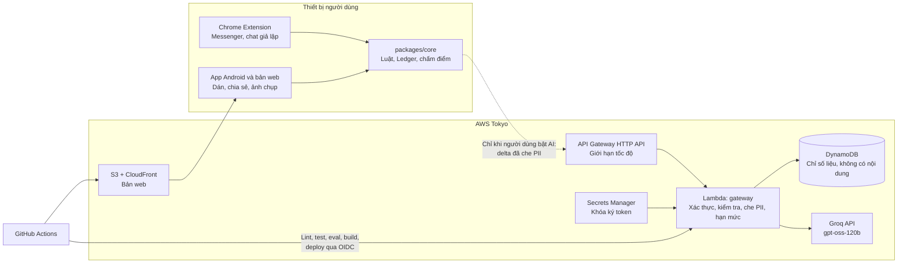

# 03. Kiến trúc mục tiêu (local-first + Groq)

Cập nhật 2026-11-07: giai đoạn hiện tại **không dùng AWS thật**. Gateway Hono chạy local (hoặc Lambda khi cần) và gọi **Groq `openai/gpt-oss-120b`**; hạ tầng AWS SAM đã có sẵn nhưng chỉ deploy khi nhóm chuyển sang giai đoạn AWS. Gemini chỉ là đối chứng trong benchmark, không chạy trong sản phẩm.

## 1. Quyết định trung tâm

**Thêm một AI Gateway không lưu nội dung, chạy local trước và có thể đóng gói lên AWS Lambda. Luật vẫn chạy trên máy.**

Bản trước không có backend nên giữ được quyền riêng tư, nhưng thiếu kiểm soát chi phí và buộc người dùng tự có khóa. Gateway giữ nguyên lời hứa cốt lõi và bổ sung lợi ích thật:

| Trước | Sau |
|---|---|
| Người dùng tự xin và tự lưu Groq key | Không cần key. Gateway giữ Groq key trong secret, không có khóa model trong extension |
| Không kiểm soát được chi phí | Hạn mức theo thiết bị, trần ngân sách toàn hệ thống |
| Không đo được chi phí, độ trễ | Số liệu tổng hợp theo model, không chứa nội dung |
| Chỉ có Chrome máy tính | Có thêm app Android và bản web |

**Điều không đổi:**
- Không bật AI thì không có gì rời khỏi thiết bị.
- Backend không lưu và không log nội dung tin nhắn.
- Rào chặn AI giữ nguyên: trích dẫn phải khớp, không tự lên Nghiêm trọng, hạ tối đa 1 bậc.

## 2. Vai trò của từng loại credit

| Nguồn | Dùng cho | Không dùng cho |
|---|---|---|
| **Groq** (giai đoạn hiện tại) | Gateway local, `gpt-oss-120b`, demo | Chat thật ngoài phạm vi bài thi |
| **Tài khoản AWS production** (Danh) | Gateway, web, dữ liệu khi bật AWS thật | Benchmark nặng |
| **Tài khoản AWS benchmark** (Duy) | Thang model trên Bedrock (dự phòng, chưa dùng) | Bản demo |
| **Credit Google GDP** (5 USD/Gmail) | Hỗ trợ lúc phát triển. Duy giữ 1 suất cho đối chứng Gemini | Bất kỳ phần nào của demo |
| OpenRouter (tùy chọn, nạp 10 USD) | Bậc model free trong benchmark | Chat thật |

Tách hai tài khoản AWS để benchmark tiêu quá cũng không làm dừng bản demo.

## 3. Cách đăng ký AWS và vùng triển khai (chỉ khi bật AWS thật)

Phần này giữ lại cho giai đoạn sau. Hiện tại nhóm chạy local với Groq, không cần tài khoản AWS.

AWS có 2 kiểu đăng ký, khác nhau đáng kể:

| | Sign up (new) | **Sign up (advanced), có root user** |
|---|---|---|
| Chọn vùng | Không. Địa chỉ Việt Nam bị gán Sydney | **Có** |
| Tính năng đa vùng | Tài liệu ghi không hỗ trợ | Có |
| AWS Marketplace | Tài liệu chưa nhất quán | Có |
| Giới hạn chi tiêu sẵn có | Có | Không, dùng AWS Budgets |
| Đăng nhập | AWS Builder ID, mời thành viên vào project | Root + IAM user |

**Chọn `Sign up (advanced)`** vì nó không bị khóa vùng và không bị cấm đa vùng, trong khi model Claude trên Bedrock cần inference profile. Chưa xác nhận kiểu này có đủ 200 USD không, nên phải xem màn hình credit ngay sau khi tạo. Giữ **Free plan**: tài khoản dừng khi hết credit, không tự trừ thẻ.

**Chọn vùng Tokyo (`ap-northeast-1`), không chọn Singapore:**

| Vùng | Claude Haiku/Opus 5.5 | Nova 2 Lite | Hệ quả |
|---|---|---|---|
| Singapore | Chỉ profile Global | Chỉ profile Global | Dữ liệu có thể xử lý ở bất kỳ vùng thương mại nào |
| **Tokyo** | Profile `jp.` | Profile `jp.` | **Chỉ xử lý ở Tokyo và Osaka** |
| Sydney (nếu buộc dùng Sign up new) | Profile `au.` | Chỉ Global | Claude ở lại Úc |

Độ trễ thêm so với Singapore là nhỏ so với vài giây chờ model. Số thật sẽ đo ở load test.

## 4. Sơ đồ



## 5. Cấu trúc repo

```
Hkth_safechatAI/
  docs/                 tài liệu kế hoạch, báo cáo
  packages/core/        chuyển từ src/core (không gọi chrome.*)
  apps/extension/       chuyển từ src/{content,background,sidepanel,shared}, public/
  apps/web/             kiểm tra đoạn chat, trang kịch bản, dashboard (Vite, TypeScript)
  apps/mobile/          Capacitor bọc apps/web thành app Android, nhận share intent
  services/gateway/     Hono + TypeScript, chạy local trước; đóng gói được lên Lambda
  infra/                template AWS SAM cho staging và production
  research/             khung đánh giá, giữ nguyên quy tắc dev/test
  fixtures/  tests/
  .github/workflows/    ci.yml, deploy.yml, release.yml
```

Dùng npm workspaces. Việc di chuyển giới hạn trong **60 phút**, được 187 test bảo vệ. Quá giờ thì giữ `` nguyên trạng và thêm `services/`, `apps/web/` bên cạnh, import core qua đường dẫn tương đối.

Dùng lại **cùng repo GitHub** để giữ lịch sử và tag `eval/dot-*`, vì tái lập số liệu dựa vào các tag này.

Phần gọi model viết sau một interface nhỏ, để đổi model hoặc nhà cung cấp mà không sửa luồng xử lý.

## 6. API

| Phương thức | Đường dẫn | Việc |
|---|---|---|
| POST | `/v1/devices` | Cấp token ẩn danh ngắn hạn, không thu thông tin cá nhân |
| POST | `/v1/analyses` | Phân tích delta đã che PII, trả tín hiệu đã kiểm tra trích dẫn |
| POST | `/v1/screenshots:extract` | (P1) Đọc chữ và người gửi từ ảnh, cần đồng ý riêng, không lưu ảnh, không dùng model miễn phí |
| POST | `/v1/feedback` | Ghi "đúng" hoặc "báo nhầm" kèm mã luật và mức, **không có nội dung** |
| GET | `/v1/metrics/summary` | Số liệu tổng hợp ẩn danh; **cần admin token** qua `Authorization: Bearer` |
| GET | `/healthz` · `/readyz` | Kiểm tra sống và sẵn sàng |

**Luồng `POST /v1/analyses`:**
1. Xác thực token, kiểm tra hạn mức thiết bị và trần ngân sách. Vượt trần trả 429 hoặc 503, client tiếp tục dùng luật.
2. Kiểm tra schema (Zod), giới hạn kích thước.
3. Che PII lần hai phía server, không tin dữ liệu từ client.
4. Chọn tầng model, gọi Groq Chat Completions (`response_format: json_object`), có timeout và thử lại có giới hạn.
5. Kiểm tra đầu ra bằng chính `core/evidence.ts`; lọc câu kết luận tội phạm.
6. Trả kết quả, ghi số token, chi phí, độ trễ. Không ghi prompt, tin nhắn, trích dẫn.

**Lỗi và dự phòng:** Gateway hoặc model lỗi thì kết quả luật vẫn hiển thị và không bị hạ mức, đúng hành vi hiện có.

## 7. Dữ liệu (DynamoDB)

Một bảng `safechat-<môi trường>`, tính phí theo lượt, có thuộc tính TTL.

| Loại bản ghi | Khóa chính (PK / SK) | Trường | Hạn lưu |
|---|---|---|---|
| Hạn mức thiết bị | `DEV#{hash thiết bị}` / `DAY#{ngày}` | số lượt | TTL 2 ngày |
| Hạn mức cấp token | `IP#{hash IP}` / `ISSUE#{phút}` | số lượt | TTL 2 phút |
| Ngân sách toàn cục | `GLOBAL` / `DAY#{ngày}` | số lượt, token vào | TTL 2 ngày |
| Số liệu | `METRIC#{ngày}#{shard}` / `COUNTER`; `METRIC#{ngày}` / `MODEL#{model}#{tier}` | lượt, token vào/ra, lỗi, histogram độ trễ, số trích dẫn bị loại | TTL 90 ngày |
| Phản hồi | `FEEDBACK#{ngày}` / `V#{verdict}` hoặc `TYPE#{mã luật}` | bộ đếm đúng/nhầm, mã luật | TTL 90 ngày |

- Mọi truy cập đi theo khóa, không dùng Scan.
- Bộ đếm cộng nguyên tử bằng `UpdateItem ... ADD`, tổng chi tiêu hôm nay là cơ sở của trần ngân sách.
- Dashboard đọc qua cache trong tiến trình 60 giây để giảm số lượt đọc.
- Không lưu cache phản hồi model ra đĩa vì phản hồi có thể chứa trích dẫn. Nếu cần chỉ dùng cache trong bộ nhớ, TTL ngắn.

## 8. Triển khai và bảo mật

Mục này mô tả cấu hình **khi bật AWS**. Giai đoạn hiện tại chạy gateway local (`npm run dev:gateway`), dùng store trong bộ nhớ và `.env`; các bước deploy bên dưới chỉ áp dụng khi nhóm chuyển sang AWS.

| Hạng mục | Lựa chọn |
|---|---|
| Vùng | `ap-northeast-1` (Tokyo). CloudFront là dịch vụ toàn cầu |
| Môi trường | Stack `safechat-staging`, `safechat-prod` |
| Quy mô | Lambda tính theo lượt gọi. `ReservedConcurrentExecutions=5`, API Gateway throttling 20 req/s (burst 40) để chặn chi phí. Làm nóng trước demo |
| Không dùng | App Runner (đã đóng với khách hàng mới), ECS + Load Balancer (có khả năng tốn hơn khi rảnh; chưa kiểm tra giá) |
| CI | Mọi PR: gitleaks, typecheck, test, eval so mốc, build extension, build gateway (chưa cấu hình ESLint nên không chạy lint giả) |
| CD | Chỉ chạy khi `vars.DEPLOY_AWS=true`. Merge `main` → staging + smoke test; tag `v*` → production, đóng gói extension thành zip trong GitHub Release. Job riêng build APK debug thành artifact nội bộ, không đưa vào Release công khai |
| Xác thực deploy | GitHub OIDC, role chỉ tin đúng repo và nhánh, không có access key dài hạn |
| Bí mật | Secrets Manager cho khóa ký token và Groq API key. IAM role cho Lambda với quyền tối thiểu; local dùng `.env` không commit |
| Tài khoản | Bật MFA cho root, không tạo access key cho root, dùng IAM cho việc hằng ngày |
| Mạng | HTTPS sẵn có của API Gateway và CloudFront, S3 không public, CORS chỉ cho web, origin của app Capacitor và ID extension cố định, security header, giới hạn tốc độ theo route và theo thiết bị |
| Log | CloudWatch chỉ ghi số liệu kỹ thuật, giữ 7 ngày; không ghi prompt, tin nhắn, trích dẫn hay `detail` lỗi parse. **Không bật log nội dung của nhà cung cấp model** |
| Ngân sách | AWS Budgets (tùy chọn, cảnh báo 80% chi phí tháng) + trần lượt/token tự ngắt trong code |

**Sửa extension:**
- Thay Groq bằng gateway trong `optional_host_permissions`, cập nhật màn hình đồng ý nói rõ dữ liệu đi đâu.
- Bỏ `localhost` khỏi bản production.
- Sửa widget: bỏ `TRUSTED_AND_UNTRUSTED_CONTEXTS`, background chỉ gửi mức và điểm (không gửi transcript), Shadow DOM `closed`, chỉ hiện sau khi đồng ý, mặc định tắt trên Facebook.

## 9. Dữ liệu gửi tới Groq

Đây là bài thi và demo dùng dữ liệu giả lập, nên các giới hạn dưới đây chỉ để trả lời khi được hỏi về thiết kế, không phải điều kiện để demo.

**Gateway:**
- Không lưu nội dung chat. DynamoDB chỉ giữ bộ đếm (số lượt, token) và bản ghi ngày.
- Không bật log nội dung. Log chỉ có mã lỗi kỹ thuật, không có prompt, tin nhắn, trích dẫn hay `detail` lỗi parse.
- Chỉ gửi delta: tin mới, 4 tin ngữ cảnh và bản tóm tắt. Số điện thoại, số tài khoản, email được che trước khi gửi.
- Token thiết bị ký HMAC, không gắn với danh tính người dùng.

**Groq (bên thứ ba):**
- Nội dung rời khỏi máy khi bật AI qua gateway. Groq là bên xử lý độc lập, áp dụng điều khoản riêng, gồm cơ chế phát hiện lạm dụng.
- **Không được nói "không ai lưu gì" khi trình bày.** Nói đúng: gateway không lưu nội dung; Groq nhận nội dung đã che PII để suy luận; chính sách lưu giữ và phát hiện lạm dụng theo điều khoản của Groq.
- Chính sách và model khả dụng **phải kiểm tra lại lúc chạy**. Nếu cần chế độ không rời máy, dùng Gemini Nano hoặc chỉ bộ quy tắc.

## 10. Chọn model

Model production là `openai/gpt-oss-120b` cho cả hai tầng. Tầng `small` là lượt nhanh (ưu tiên độ trễ), tầng `large` là lượt sâu khi leo thang; hai tầng khác nhau ở prompt và ngân sách token, không khác model. Có thể khai báo model riêng cho từng tầng bằng biến môi trường nếu sau này cần.

Chọn model theo tiêu chí viết trước khi có kết quả: JSON hợp lệ ≥ 95%, không bỏ sót nhiều hơn chỉ dùng luật, rồi xếp theo bỏ sót nguy hiểm, báo nhầm, chi phí, độ trễ. Kết quả ghi ở `docs/MODEL_REPORT.md`.

| Tầng | Model | Ghi chú |
|---|---|---|
| Nhanh (`small`) | `openai/gpt-oss-120b` | JSON mode của Groq, temperature thấp |
| Sâu (`large`) | `openai/gpt-oss-120b` | Cùng model, prompt đầy đủ và ngân sách lớn hơn |

Giá và hạn mức **phải kiểm tra lại lúc chạy**. Luật vẫn chạy trước và gửi gói gợi ý H2 cho AI nếu số đo xác nhận có ích. Gemini Nano giữ ở dạng thử nghiệm, không demo.

## 11. Không làm trong 24h

Tự huấn luyện hoặc fine-tune mô hình · RAG · iOS · viết app native từ đầu · Google Play, Chrome Web Store (thời gian duyệt ngoài tầm kiểm soát) · quyền Trợ năng hoặc đọc thông báo · adapter Zalo · tài khoản người dùng · RDS, Kubernetes, ECS · triển khai song song trên Google Cloud · lưu nội dung chat trên server.

## Nguồn

- [AWS Free Tier](https://aws.amazon.com/free/) · [Free Tier FAQs](https://aws.amazon.com/free/free-tier-faqs/)
- [So sánh các kiểu đăng ký AWS](https://docs.aws.amazon.com/accounts/latest/reference/sign-up-for-aws.html)
- [Dịch vụ hỗ trợ khi đăng ký kiểu new](https://docs.aws.amazon.com/accounts/latest/reference/supported-services-sign-up-new.html) · [Vùng của project](https://docs.aws.amazon.com/accounts/latest/reference/project-regions.html)
- [Groq — Models](https://console.groq.com/docs/models) · [Chat Completions](https://console.groq.com/docs/api-reference#chat-create) · [JSON mode](https://console.groq.com/docs/structured-outputs) · [Rate limits](https://console.groq.com/docs/rate-limits)
- [Groq — Privacy Policy](https://groq.com/privacy-policy/) · [GroqCloud Terms](https://groq.com/terms-of-use/)
- [Thay đổi về App Runner](https://docs.aws.amazon.com/apprunner/latest/dg/apprunner-availability-change.html)
- [GitHub OIDC với AWS](https://docs.github.com/actions/deployment/security-hardening-your-deployments/configuring-openid-connect-in-amazon-web-services) · [SAM Pipelines và OIDC](https://aws.amazon.com/blogs/compute/securing-ci-cd-pipelines-with-aws-sam-pipelines-and-oidc/)
