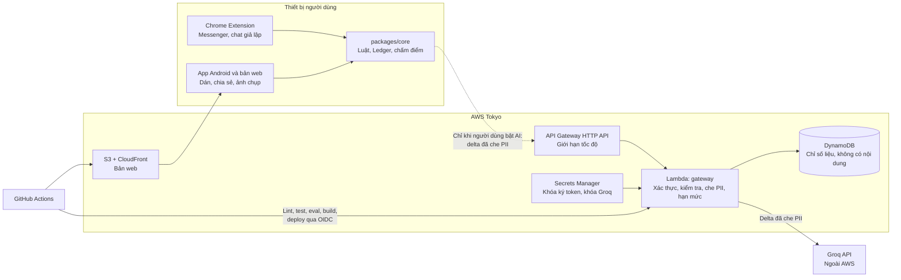

# 03. Kiến trúc mục tiêu (AWS)

Đã chốt 2026-11-07: **hạ tầng triển khai trên AWS, model chạy qua Groq.** Nhóm dừng ở Tầng 1.

| Tầng | Thành phần | Trạng thái |
|---|---|---|
| **0** | Bộ luật chạy trên thiết bị. Miễn phí, không gửi dữ liệu | Có sẵn. Đây là đường đảm bảo: gateway chết thì client vẫn có kết quả luật |
| **1** | Groq, gọi từ gateway trên AWS khi người dùng bật AI | **Phạm vi bài thi** |
| 2 | Bedrock, bật bằng `AI_PROVIDER=bedrock` | Ngoài phạm vi. Chưa có code gọi model. Chỉ làm nếu còn giờ, và không được trình bày là đã kiểm chứng |

Không huấn luyện model trên Bedrock: chỉ có 53 ca lừa đảo, nhãn trùng với nguồn dữ liệu ([EXP-006](../research/experiments/EXP-006/README.md)), và fine-tuning không có ở Tokyo. Gemini chỉ là đối chứng trong benchmark.

## 1. Quyết định trung tâm

**Thêm một AI Gateway không lưu nội dung trên AWS Lambda. Luật vẫn chạy trên máy.**

Bản trước không có backend nên giữ được quyền riêng tư, nhưng thiếu kiểm soát chi phí và buộc người dùng tự có khóa. Gateway giữ nguyên lời hứa cốt lõi và bổ sung lợi ích thật:

| Trước | Sau |
|---|---|
| Người dùng tự xin và tự lưu Groq key | Không cần key. Khóa Groq nằm trong Secrets Manager, không ở trên máy người dùng |
| Không kiểm soát được chi phí | Hạn mức theo thiết bị, trần ngân sách toàn hệ thống |
| Không đo được chi phí, độ trễ | Số liệu tổng hợp theo model, không chứa nội dung |
| Chỉ có Chrome máy tính | Có thêm app Android và bản web |

**Điều không đổi:**
- Không bật AI thì không có gì rời khỏi thiết bị.
- Bật AI thì delta đã che PII đi qua gateway rồi ra Groq, tức là **ra ngoài AWS**. Màn hình đồng ý phải nói rõ điều này.
- Không gửi chat thật qua gói miễn phí. Demo và đánh giá chỉ dùng dữ liệu giả lập; thử trên Messenger thật thì tắt AI.
- Backend không lưu và không log nội dung tin nhắn.
- Rào chặn AI giữ nguyên: trích dẫn phải khớp, không tự lên Nghiêm trọng, hạ tối đa 1 bậc.

## 2. Vai trò của từng tài nguyên

| Nguồn | Dùng cho | Không dùng cho |
|---|---|---|
| **Tài khoản AWS** (Danh) | Gateway, web, dữ liệu, Secrets Manager | Benchmark |
| **Khóa Groq production** (Danh) | Gateway staging và production | Benchmark |
| **Khóa Groq benchmark** (Duy) | Đo model trên tune | Bản demo |
| **Credit Google GDP** | Hỗ trợ lúc phát triển. Duy giữ 1 suất cho đối chứng Gemini | Bất kỳ phần nào của demo |
| OpenRouter (tùy chọn) | Bậc model free trong benchmark | Chat thật |

Tách hai khóa Groq trên hai tài khoản để benchmark dùng hết hạn mức cũng không làm dừng bản demo. Mỗi người chỉ dùng tài khoản của mình và không tạo thêm tài khoản AWS để lấy credit, vì trang FAQ của FCAJ ghi việc đó vi phạm điều khoản Free Tier.

## 3. Tài khoản AWS và vùng triển khai

- **Giữ Free plan.** Tầng 1 không cần Paid plan. Nâng Paid không hoàn tác được và phải được cả nhóm đồng ý.
- **Vùng Tokyo (`ap-northeast-1`)** cho Lambda, API Gateway, DynamoDB, S3 và Secrets Manager. Đã có tài khoản ở vùng khác thì dùng tiếp, không cần tạo lại.
- **Kiểm tra gói:** `aws freetier get-account-plan-state --region us-east-1`.
- **Về Bedrock:** FAQ của FCAJ (trang cộng đồng, không phải tài liệu AWS) ghi Free plan không dùng được AWS Marketplace, trong khi tài liệu AWS mô tả khác. Nếu FAQ đúng thì chờ không làm Claude trên Bedrock mở lại được, nên kế hoạch không phụ thuộc vào Bedrock.

## 4. Sơ đồ



## 5. Cấu trúc repo

```
Hkth_safechatAI/
  docs/                 tài liệu kế hoạch, báo cáo
  packages/core/        chuyển từ src/core (không gọi chrome.*)
  apps/extension/       chuyển từ src/{content,background,sidepanel,shared}, public/
  apps/web/             kiểm tra đoạn chat, trang kịch bản, dashboard (Vite, TypeScript)
  apps/mobile/          Capacitor bọc apps/web thành app Android, nhận share intent
  services/gateway/     Hono + TypeScript trên Lambda
  infra/                template AWS SAM cho staging và production
  research/             khung đánh giá, giữ nguyên quy tắc dev/test
  fixtures/  tests/
  .github/workflows/    ci.yml, deploy.yml, release.yml
```

Dùng npm workspaces. Việc di chuyển giới hạn trong **60 phút**, được 187 test bảo vệ. Quá giờ thì giữ `` nguyên trạng và thêm `services/`, `apps/web/` bên cạnh, import core qua đường dẫn tương đối.

Dùng lại **cùng repo GitHub** để giữ lịch sử và tag `eval/dot-*`, vì tái lập số liệu dựa vào các tag này.

Phần gọi model viết sau một interface nhỏ, để đổi model hoặc nhà cung cấp mà không sửa luồng xử lý.

## 6. API

| Phương thức | Đường dẫn | Việc |
|---|---|---|
| POST | `/v1/devices` | Cấp token ẩn danh ngắn hạn, không thu thông tin cá nhân |
| POST | `/v1/analyses` | Phân tích delta đã che PII, trả tín hiệu đã kiểm tra trích dẫn |
| POST | `/v1/screenshots:extract` | (P1) Đọc chữ và người gửi từ ảnh, cần đồng ý riêng, không lưu ảnh, không dùng model miễn phí |
| POST | `/v1/feedback` | Ghi "đúng" hoặc "báo nhầm" kèm mã luật và mức, **không có nội dung** |
| GET | `/v1/metrics/summary` | Số liệu tổng hợp công khai: lượt gọi, chi phí, độ trễ |
| GET | `/healthz` · `/readyz` | Kiểm tra sống và sẵn sàng |

**Luồng `POST /v1/analyses`:**
1. Xác thực token, kiểm tra hạn mức thiết bị và trần ngân sách. Vượt trần trả 429 hoặc 503, client tiếp tục dùng luật.
2. Kiểm tra schema (Zod), giới hạn kích thước.
3. Che PII lần hai phía server, không tin dữ liệu từ client.
4. Chọn model nhỏ hoặc lớn, gọi provider đang đặt ở `AI_PROVIDER`, có timeout và thử lại có giới hạn. Groq báo hết hạn mức (429) thì trả `QUOTA_EXCEEDED`.
5. Kiểm tra đầu ra bằng chính `core/evidence.ts`; lọc câu kết luận tội phạm.
6. Trả kết quả, ghi số token, chi phí, độ trễ. Không ghi prompt, tin nhắn, trích dẫn.

**Lỗi và dự phòng:** Gateway hoặc model lỗi thì kết quả luật vẫn hiển thị và không bị hạ mức, đúng hành vi hiện có.

## 7. Dữ liệu (DynamoDB)

Một bảng `safechat-<môi trường>`, tính phí theo lượt, có thuộc tính TTL.

| Loại bản ghi | Khóa chính (PK / SK) | Trường | Hạn lưu |
|---|---|---|---|
| Hạn mức | `QUOTA#{hash thiết bị}` / `{ngày}` | số lượt | TTL 2 ngày |
| Chi tiêu | `USAGE#{ngày}` / `{model}` | lượt, token vào/ra, chi phí, tổng độ trễ, số trích dẫn bị loại | Dài hạn |
| Phản hồi | `FEEDBACK#{ngày}` / `{mã ngẫu nhiên}` | mức, mã luật, đúng/nhầm | TTL 90 ngày |

- Mọi truy cập đi theo khóa, không dùng Scan.
- Bộ đếm cộng nguyên tử bằng `UpdateItem ... ADD`, tổng chi tiêu hôm nay là cơ sở của trần ngân sách.
- Dashboard đọc qua cache trong tiến trình 60 giây để giảm số lượt đọc.
- Không lưu cache phản hồi model ra đĩa vì phản hồi có thể chứa trích dẫn. Nếu cần chỉ dùng cache trong bộ nhớ, TTL ngắn.

## 8. Triển khai và bảo mật

| Hạng mục | Lựa chọn |
|---|---|
| Vùng | `ap-northeast-1` (Tokyo). CloudFront là dịch vụ toàn cầu |
| Môi trường | Stack `safechat-staging`, `safechat-prod` |
| Quy mô | Lambda tính theo lượt gọi. `reserved concurrency` thấp để chặn chi phí. Làm nóng trước demo |
| Không dùng | Bedrock trong Tầng 1. App Runner (đã đóng với khách hàng mới), ECS + Load Balancer (có khả năng tốn hơn khi rảnh; chưa kiểm tra giá) |
| CI | Mọi PR: ESLint, typecheck, test, eval so mốc, build, gitleaks |
| CD | Merge `main` → staging + smoke test; tag `v*` → production, đóng gói extension thành zip trong GitHub Release. Job riêng build APK debug thành artifact nội bộ, không đưa vào Release công khai |
| Xác thực deploy | GitHub OIDC, role chỉ tin đúng repo và nhánh, không có access key dài hạn |
| Bí mật | Secrets Manager cho khóa ký token và khóa Groq. IAM role cho Lambda với quyền tối thiểu, chỉ đọc đúng các secret này. Bỏ quyền `bedrock:InvokeModel` |
| Tài khoản | Bật MFA cho root, không tạo access key cho root, dùng IAM cho việc hằng ngày |
| Mạng | HTTPS sẵn có của API Gateway và CloudFront, S3 không public, CORS chỉ cho web, origin của app Capacitor và ID extension cố định, security header, giới hạn tốc độ theo route và theo thiết bị |
| Log | CloudWatch chỉ ghi số liệu kỹ thuật, giữ 7 ngày. Lỗi từ Groq không được ghi nguyên văn nếu có thể chứa nội dung gửi đi |
| Ngân sách | AWS Budgets cảnh báo 25/50/75%. Trần token mỗi ngày tự ngắt trong code, thấp hơn hạn mức Groq |
| Hạn mức Groq | Dùng chung cho mọi người dùng, nên cần giới hạn theo thiết bị. Hết hạn mức thì client giữ kết quả luật |

**Sửa extension:**
- Extension không gọi thẳng Groq nữa. Thay `api.groq.com` bằng gateway trong `optional_host_permissions`. Màn hình đồng ý nêu rõ dữ liệu đi qua gateway rồi đến Groq.
- Bỏ `localhost` khỏi bản production.
- Sửa widget: bỏ `TRUSTED_AND_UNTRUSTED_CONTEXTS`, background chỉ gửi mức và điểm (không gửi transcript), Shadow DOM `closed`, chỉ hiện sau khi đồng ý, mặc định tắt trên Facebook.

## 9. Groq và dữ liệu

Đây là bài thi và demo dùng dữ liệu giả lập, nên các điểm dưới đây để trả lời khi được hỏi về thiết kế.

**Tài liệu Groq nêu:** mặc định không giữ dữ liệu suy luận lâu dài, nhưng có thể giữ tới 30 ngày để giám sát hệ thống. Zero Data Retention bật được trong Data Controls. Chưa xác nhận được câu "không dùng để huấn luyện" trong tài liệu đã đọc.

**Khi trình bày, không nói "không ai lưu gì".** Nói đúng: gateway không lưu nội dung; tin đã che PII mới gửi tới Groq; Groq có thể giữ tối đa 30 ngày để giám sát trừ khi bật ZDR; nhóm chưa dùng cho chat thật.

**Đổi nhà cung cấp:** phần gọi model nằm sau một interface, chọn bằng `AI_PROVIDER`. Prompt và kiểm tra đầu ra vẫn ở `@safechat/core/ai` nên không đổi theo nhà cung cấp.

## 10. Chọn model

Tiêu chí viết trước khi có kết quả: JSON hợp lệ ≥ 95%, không bỏ sót nhiều hơn chỉ dùng luật, rồi xếp theo bỏ sót nguy hiểm, báo nhầm, độ trễ, số token. Kết quả ghi trong `research/experiments` và `docs/MODEL_REPORT.md`.

| Vai trò | Ứng viên trên Groq | Ghi chú |
|---|---|---|
| Nhỏ (`MODEL_SMALL`) | `llama-3.1-8b-instant`, `openai/gpt-oss-20b` | Dùng cho đa số lượt gọi |
| Lớn (`MODEL_LARGE`) | `llama-3.3-70b-versatile`, `openai/gpt-oss-120b` | Dùng khi tín hiệu luật đáng ngờ, tốn hạn mức hơn |

Danh sách model và hạn mức miễn phí **phải kiểm tra lại lúc chạy** ở trang Limits của tài khoản Groq. Chưa model nào được đo trên tune. Gemini Nano giữ ở dạng thử nghiệm, không demo.

## 11. Không làm trong 24h

Tự huấn luyện hoặc fine-tune mô hình · RAG · iOS · viết app native từ đầu · Google Play, Chrome Web Store (thời gian duyệt ngoài tầm kiểm soát) · quyền Trợ năng hoặc đọc thông báo · adapter Zalo · tài khoản người dùng · RDS, Kubernetes, ECS · triển khai song song trên Google Cloud · lưu nội dung chat trên server.

## Nguồn

- [Groq: Models](https://console.groq.com/docs/models) · [Rate limits](https://console.groq.com/docs/rate-limits) · [Structured outputs](https://console.groq.com/docs/structured-outputs) · [Your data](https://console.groq.com/docs/your-data)
- [FAQ của FCAJ](https://000001.awsfcaj.com/vi/7-faq---gi%E1%BA%A3i-%C4%91%C3%A1p-m%E1%BB%8Di-th%E1%BA%AFc-m%E1%BA%AFc/) (trang cộng đồng)
- [AWS Free Tier](https://aws.amazon.com/free/) · [Free Tier FAQs](https://aws.amazon.com/free/free-tier-faqs/)
- [So sánh các kiểu đăng ký AWS](https://docs.aws.amazon.com/accounts/latest/reference/sign-up-for-aws.html)
- [Dịch vụ hỗ trợ khi đăng ký kiểu new](https://docs.aws.amazon.com/accounts/latest/reference/supported-services-sign-up-new.html) · [Vùng của project](https://docs.aws.amazon.com/accounts/latest/reference/project-regions.html)
- [Thay đổi về App Runner](https://docs.aws.amazon.com/apprunner/latest/dg/apprunner-availability-change.html)
- [GitHub OIDC với AWS](https://docs.github.com/actions/deployment/security-hardening-your-deployments/configuring-openid-connect-in-amazon-web-services) · [SAM Pipelines và OIDC](https://aws.amazon.com/blogs/compute/securing-ci-cd-pipelines-with-aws-sam-pipelines-and-oidc/)
